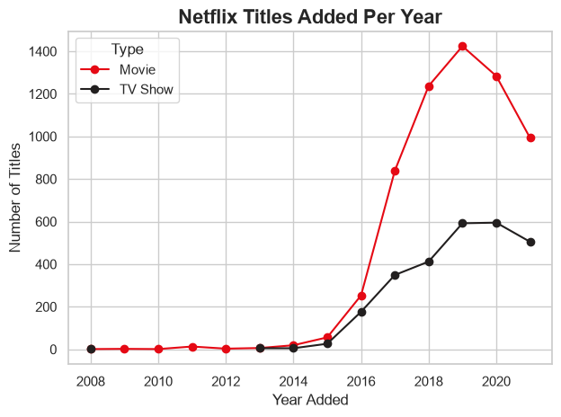
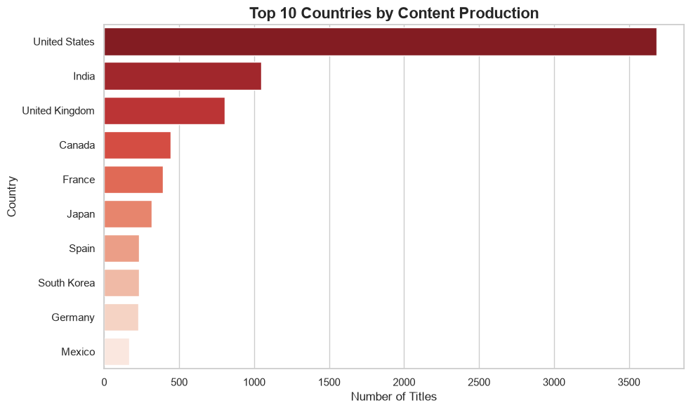

# Netflix Movies & TV Shows: Data Analysis Project

## 📌 Project Overview
This project is an end-to-end data analysis of the Kaggle **"Netflix Movies and TV Shows"** dataset (approx. 8,800 titles). The goal is to demonstrate a robust data manipulation pipeline, from raw data ingestion and cleaning to exploratory data analysis (EDA).

This repository follows a phased approach. **Current Status: Phase 1 (Data Cleaning & EDA) Complete.**

## 📊 Dataset
*   **Source:** Kaggle - Netflix Movies and TV Shows
*   **File:** `data/netflix_titles.csv`
*   **Raw Size:** 8,807 rows, 12 columns.

## 🛠️ Tech Stack & Tools
*   **Environment:** VS Code (Jupyter Notebooks)
*   **Language:** Python 3.x
*   **Data Manipulation:** `pandas`, `numpy`
*   **Data Visualization:** `matplotlib`, `seaborn`

## 🧹 Data Cleaning Pipeline (Phase 1)
The raw data contained several anomalies that required a systematic cleaning approach. To ensure reproducibility and clean code architecture, the entire process was encapsulated into a reusable Python function (`clean_netflix()`) located in `analysis.ipynb`. 

Key data manipulation steps included:
1.  **Whitespace & Types:** Stripped leading/trailing spaces from all string columns.
2.  **Date Parsing:** Converted `date_added` from a string to a `datetime` object and extracted `year_added` and `month_added`.
3.  **Rating Bug Fix:** Identified 3 rows where movie durations (e.g., `"74 min"`) were incorrectly recorded in the `rating` column. Moved these to the `duration` column and handled the resulting missing ratings.
4.  **Missing Values:** 
    *   Filled missing `director`, `cast`, and `country` with `"Unknown"` to preserve row counts without biasing calculations.
    *   Dropped exactly 10 rows missing `date_added` (required for time-series analysis).
5.  **Duration Split:** Split the string `duration` column into two numeric columns: `duration_min` (for Movies) and `n_seasons` (for TV Shows).
6.  **Feature Engineering:** Created `years_to_netflix`, `decade`, and `is_recent` columns for deeper temporal analysis.

**Final Output:** A clean dataset with 8,797 rows and 18 columns, with 0 missing values in critical columns.

## 📈 Key Findings
*   **Explosive Growth:** Netflix saw massive content expansion between 2015 and 2019. TV Shows saw a massive surge, showing a shift in content strategy.
*   **Global Dominance:** The United States is the top content producer, followed by India and the UK.
*   **Genre Focus:** International Movies, Dramas, and Comedies dominate the platform.
*   **Mature Audiences:** The vast majority of content is rated TV-MA, TV-14, or R.

### 📊 Visualizations

**Titles Added Per Year (Movies vs. TV Shows):**


**Top 10 Countries by Content Production:**


## 🚀 How to Run Locally

**1. Clone the repository:**
```bash
git clone https://github.com/YoussefSlimi/netflix-data-analysis.git
cd netflix-data-analysis